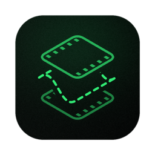
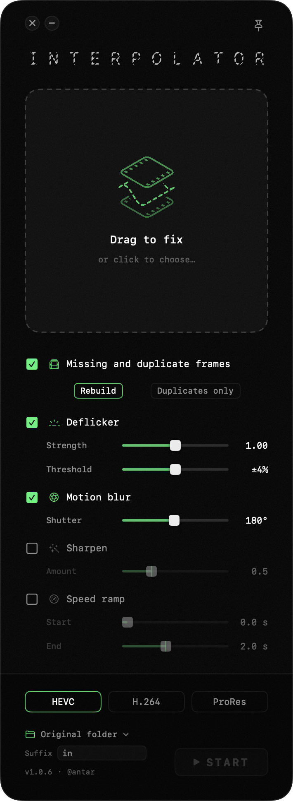

<p align="center"></p>

# INTERPOLATOR

Rebuilds the frames a video is missing. Interpolator finds the places where a clip stutters, flickers or lacks motion blur, and repairs them on the Mac GPU: missing frames are reconstructed from their neighbours along the measured motion of the picture, by a deterministic algorithm. The same clip always gives the same result, and the quality of every rebuilt frame can be measured.

It was made for AI-generated video, where a frame is duplicated or dropped about once per second, and it works just as well on real footage:

- **AI video**: the once-per-second stutter, brightness flicker, backgrounds that pop for one frame, motion with no blur.
- **Camera footage**: shots made with a shutter too fast for the frame rate (staccato motion) or with shutters that do not match from one clip to the next; flicker from artificial light or time-lapse; frames dropped by a recorder or a screen capture.
- **Converted and downloaded material**: the repeated or missing frames left behind by a frame-rate conversion (25 to 24 or 30 fps and the like).
- **Finished edits**: a timeline of several clips with cuts can be checked and repaired in one go; each stretch is judged on its own evidence.
- **Automation**: queue any number of files in the app, or let an AI agent run the check after every clip it generates, before upscaling or grading.

It is one engine with two ways in:

| | For | How |
|---|---|---|
| **The app** | People | A small window: drop your videos, read what was found, press START. |
| **The `interpolator` command** | AI agents and scripts | The same engine from the command line, with a ready-made skill that teaches an agent (Claude Code, Codex and others) when and how to use it. |

Both come in the same download and always stay in step: updating the app updates the command and the skill.

<p align="center"></p>

## How it works

For the curious. The whole method is classical image processing; PyTorch runs the arithmetic on the GPU.

1. **Finding what is missing.** The difference between each frame and the next is measured across the clip. A duplicate is a step of almost zero; a missing frame is an isolated step about one and a half times longer than its neighbours. In AI video these form a chain with a period of about one second, so the pattern itself confirms each find, and a position suggested only by the pattern is kept only if the measured motion there really is longer.
2. **Measuring the motion.** Blocks of the picture are matched between the two frames around the gap on a grid of nodes, in three passes from coarse to fine (a node every 60, then 20, then 8 pixels), with sub-pixel precision. Block matching is used in place of dense optical flow, which invents motion on flat areas such as sky or sea.
3. **Checking every vector.** Each node gets three candidates: its own local estimate, the dominant motion of the area around it, and the camera motion of the whole frame. The one that best predicts the real next frame, tested on the pixels, wins. Then each vector is compared with the same node in the neighbouring frame pairs: a camera moves smoothly, so a wrong vector stands out in time and is replaced.
4. **Building the frame.** The frame before and the frame after are each moved halfway along the verified motion and blended. The result sits exactly where the missing frame would have been.
5. **Motion blur from the same field.** Up to 32 copies of each frame are spread along its motion, spaced closely enough to form a continuous trail, for the shutter angle you choose (180° is the cinema standard). Where the motion is uncertain, no trail is drawn.
6. **Flicker.** The brightness of each frame is compared with its own smoothed curve over time and corrected by a small gain, capped at ±4 %: anything larger is treated as a real change of light and left alone.

How good is a rebuilt frame? The `loo` command answers with a number: it removes real frames from a clip, rebuilds them from their neighbours and reports how close each one is to the original (PSNR).

## What it fixes

| Problem | What Interpolator does |
|---|---|
| A frame repeated about once per second | removes the duplicate |
| A frame missing about once per second (a small jump in the motion) | rebuilds it from its neighbours, following the real motion |
| Flicker (the whole picture getting slightly brighter and darker) | evens the brightness out; real light changes are left alone |
| A still background that pops for a single frame | repairs it from the frames before and after |
| A black background that is not quite black, with noise that comes and goes | cleans it to pure black |
| No motion blur | adds blur along the motion of each area, like a real camera shutter |
| Soft image | optional sharpening |
| A clip that starts or stops abruptly | speed ramp: the first or last seconds ease in from, or out to, a standstill |

The clip keeps its own frame rate (23.976 to 60 fps). Audio can be kept, re-synced or removed. Output is HEVC, H.264 or ProRes 422 HQ. The original file is never touched.

## Install

1. Download **[Interpolator.dmg](https://github.com/antarcorrado/interpolator/releases/latest/download/Interpolator.dmg)**.
2. Open it and drag Interpolator to Applications.
3. Open Interpolator. The first time, it sets itself up: it downloads Python, PyTorch and ffmpeg (about 300 MB, a few minutes, internet needed). Nothing else to install.

You need macOS 13 or later, on Apple Silicon or Intel.

The app is signed and notarised by Apple, so it opens without warnings. It checks for a new version each time you open it and updates itself.

## Use the app

1. Drop one or more videos on the window (or click to choose them).
2. Each one is analysed: you see how many frames are duplicated or missing, how much it flickers, and whether there is anything it cannot fix.
3. Choose what to correct and the output format, then press START.

The result is saved next to the original as `name_interpolator.mp4` (or `.mov` for ProRes).

## Use it from an AI agent

The first time it is opened from Applications, the app links its skill into every agent skills folder that already exists on the Mac, and a line at the bottom of the drop box confirms it:

| Folder | Read by |
|---|---|
| `~/.claude/skills` | Claude Code and the Code tab of the Claude desktop app (also Cursor and OpenCode) |
| `~/.agents/skills` | the shared folder: Codex, Cursor, Gemini CLI, GitHub Copilot, OpenCode |
| `~/.codex/skills`, `~/.cursor/skills`, `~/.gemini/skills`, `~/.copilot/skills`, `~/.config/opencode/skills` | each agent's own folder |

Folders are never created: an agent you start using later is picked up with **Help → Install Agent Skill…**. Then just ask:

> Check this clip with Interpolator and tell me what you find.

The agent analyses the clip, reports the problems, asks which corrections you want, runs them and verifies the result.

For any other agent, or for a chat app where skills are uploaded by hand, the instructions file is inside the app:

```
/Applications/Interpolator.app/Contents/Resources/skill/interpolator/SKILL.md
```

The skill is a link into the app, so it is always the version that matches the app you have.

## Use it from the command line

The command is inside the app:

```bash
/Applications/Interpolator.app/Contents/Resources/skill/interpolator/interpolator
```

To call it simply `interpolator`, link it once into a folder on your `PATH`:

```bash
sudo ln -s /Applications/Interpolator.app/Contents/Resources/skill/interpolator/interpolator /usr/local/bin/interpolator
```

Then:

```bash
interpolator analyze clip.mp4                 # what is wrong with the clip, as one line of JSON
interpolator process clip.mp4 fixed.mp4 --deflicker=1 --blur=0.5 --audio=sync
interpolator check fixed.mp4                  # confirms the result is clean
interpolator                                  # every command and option
```

Open the app once before using the command: the app is what installs the engine's requirements.

## Good to know

- **What gets installed.** Everything lives in `~/Library/Application Support/Interpolator` (a private Python environment and ffmpeg). To remove Interpolator completely, delete that folder and the app.
- **Privacy.** Your videos never leave your Mac. The app uses the network only for the first-time setup and to check for updates.
- **Speed.** Processing runs on the GPU. Run one job at a time: two at once are slower than one after the other.
- **Colour.** The engine works in Rec. 709. Other colour spaces (Rec. 2020, HDR) are detected and flagged before you start.
- **Known limit.** A small object moving fast on its own, such as a bird crossing the frame, may appear doubled in a rebuilt frame.

## Something is not working

In the app, choose **Help → Copy Diagnostics** and paste the result into [a new issue](https://github.com/antarcorrado/interpolator/issues) or a message to me. It contains your Mac model, the installed versions and the last lines of the log; no video content.

## Third-party software

On first launch Interpolator downloads, from their own publishers: [ffmpeg](https://ffmpeg.org) (GPL build, from evermeet.cx on Intel and martin-riedl.de on Apple Silicon), [PyTorch](https://pytorch.org), [NumPy](https://numpy.org), [Pillow](https://python-pillow.org), Python and [uv](https://docs.astral.sh/uv/). Updates are handled by [Sparkle](https://sparkle-project.org), included in the app. Each keeps its own licence.

---

Made by [@antar](https://antarcorrado.com). © Antar Corrado, all rights reserved.
